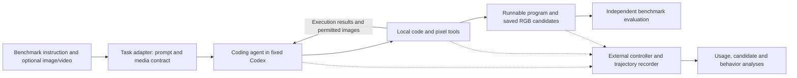

# PixelWorld framework for the paper

This is a methods draft for the intended final protocol, not a claim that all
model routes, evaluators, or full experiments have completed. The final experiment
protocol and per-run manifests determine actual configurations.

## Core framing

PixelWorld evaluates how coding agents generate or edit physically grounded
videos through executable RGB programs. Its contribution is a unified evaluation
interface with observable agent execution, supporting capability and cost analysis.
The framework preserves the coding agent's own planning, checking and revision
decisions rather than prescribing a task-specific solution workflow.

Direct RGB generation means that the agent-written program computes the video
frames with local image/pixel operations. It does not mean that the language
model emits every pixel value as a text token. The shared helper serializes and
displays already-computed frames; it does not supply scene dynamics or future
frames. Local geometry, masks, compositing, motion calculations and warps are
permitted. External image/video generators, learned renderers and simulation
engines are excluded. The PhyGenBench T2V contract additionally states that the
agent must construct the video directly in image/pixel space rather than build
a separate scene/simulation and render it into video.

## Suggested methods organization

1. **Task interface and RGB programs.** Inputs, output representation, common
   saving helper, and benchmark-specific contracts.
2. **Agent execution and visual access.** Fixed Codex runtime, Text/Vision
   conditions, autonomous tool use and candidate revision.
3. **External control, recording and evaluation.** Execution isolation, budgets,
   saved candidates, usage accounting, independent benchmark evaluation.

Keep worker hostnames, cloud mount paths, proxy ports and watchdog implementation
details in reproducibility documentation. Put the Codex version, supported effort
settings, budgets and media specifications in Experimental Setup or the appendix.

## English methods draft

### Task interface and executable RGB outputs

We introduce PixelWorld, a unified protocol for evaluating coding agents on
physically grounded video generation and editing through executable RGB programs.
Each task consists of a benchmark instruction, optional conditioning data, and an
output specification defining resolution, frame rate and duration. Conditioning
data comprise an initial image for image-to-video tasks or a factual source video
for counterfactual editing; text-to-video tasks provide no initial image. The
agent writes and executes a program that computes uint8 RGB frames with shape
\(T\times H\times W\times3\). A shared submission helper serializes these frames
and provides playback and inspection artifacts without generating scene content
or dynamics. The agent is required to retain a runnable `generate.py`.

Task adapters preserve benchmark instructions and declare the relevant temporal
constraints. Image-conditioned generation preserves the prescribed initial
frame, while PCVE editing retains the source timeline and applies the intervention
at its specified original-frame index. PhyGenBench evaluates text-conditioned
scene construction with an explicit photographic target. Benchmark evaluators
operate independently of agent execution. Physics-IQ, RoboJudge and PCVE use
pinned original scoring code; the current PhyGenBench comparison uses an
explicitly labeled GPT-5.5 judge adaptation, not hierarchical PhyGenEval.

### Agent execution and visual access

All agents operate through a fixed Codex harness with local code execution and
image/pixel operations. We compare two access conditions using the same permitted
task files. In Text, image and video data can be processed through code and
numerical outputs, while visual attachments and image-viewing tools are disabled.
In Vision, the applicable visual inputs are attached and the agent may inspect
its own generated images. For text-to-video tasks, Vision enables inspection of
generated outputs without supplying an initial image. Agents autonomously decide
how to analyze inputs, construct programs, inspect results and revise candidates.
The protocol does not prescribe an observation loop or a fixed revision count.
Each revised candidate must be saved before further revision.

### External control, recording and evaluation

A controller outside the agent supervises execution and records trajectories.
Native filesystem permissions expose the case workspace and required runtime
dependencies while excluding other experiments and evaluation data; tool networking
and external generation/simulation services are disabled. Input files, exact task
instructions, execution settings, code revisions, saved RGB candidates, tool
returns and provider-reported usage are preserved outside the agent workspace.
The record distinguishes an available image from an image actually returned to
the model and distinguishes artifact validity from physical or visual quality.

The intended final protocol assigns 1,000,000 reported output tokens to each real
model attempt and permits at most five real attempts per task and access condition.
Infrastructure interruptions are recorded separately from model non-delivery.
Budget accounting follows API-reported usage, records request-level overshoot,
and does not add reasoning tokens again when included in reported output.
We report cumulative input and output usage across calls, so repeated conversation
context contributes to execution cost. Evaluator scores are withheld from the
agent and are not used to select revisions or retries.

Saved candidates support paired first-versus-final comparisons within the same
run. Trajectories also expose how computation is allocated to input analysis,
program generation, execution feedback and checking. These observations provide
descriptive evidence of agent behavior; a revision or additional tool call alone
does not establish improved video quality or a causal benefit from extra compute.

## Framework figure

The execution feedback loop is chosen by the agent. The evaluator has no feedback
arrow into the agent. The recorder captures execution rather than supplying a
scene-specific plan or judging each intermediate candidate.

## What this framework enables us to analyze

- Text versus Vision: the effect of access through visual attachments and tools,
  with the same task files and generation contract.
- Output resolution, FPS and supported reasoning effort: quality/cost tradeoffs
  with one-factor changes and sufficient execution resources.
- PhyGenBench initialization: original T2V prompts versus agent-drawn pixel first
  frames re-rendered by Qwen, followed by fresh agent I2V. Qwen is used only for initialization,
  not video continuation. This I2V condition is a PixelWorld extension.
- Native checking and revision: first-versus-final candidate quality and additional
  consumption, separating within-run revisions from fresh attempts.
- Trace anatomy: input analysis, program writing, code execution, image inspection,
  and delivery operations. Empty polling is distinguished from error, progress and
  completion feedback; repeated input is not automatically labeled useless.

## Details to freeze before final submission

- **Termination and candidate selection.** Normal completion uses the final valid
  saved artifact. The current implementation can restore the latest verified
  snapshot saved before a token-budget crossing. State that policy explicitly and
  distinguish budget termination from RGB non-delivery. Resolve the intended
  treatment of budget-ended runs with already-valid candidates before full launch.
  Never describe candidate selection as evaluator-based best-of-N.
- **Coverage and cost denominators.** Report valid-delivery coverage. Preserve
  failed-attempt usage and state whether a cost statistic is per attempted case,
  per successful attempt, or per delivered case including retries. Infrastructure
  costs must remain separately identifiable.
- **Effort and pricing.** Verify supported upstream effort values for each route;
  equal labels are not equal compute. Use verified model-specific tariffs, identify
  unavailable cache fields, and label reference-price scenarios rather than claim
  observed billing or assign an unrelated model's price to a served alias.
- **Resources.** Confirm actual worker/job memory allocation and measure rendering
  peaks before declaring matched memory allowances or safe concurrent capacity.
  High-resolution failures caused by resource exhaustion need separate labeling.
- **Recording scope.** Preserve returned messages and tool results, not unreturned
  provider internals. Sampled candidate/code snapshots can miss rapid overwrites
  and unsaved drafts. A runnable-program requirement is not proof that every
  submission has passed a bit-identical regeneration test.
- **Evaluator parity.** Freeze evaluator commits and dataset revisions, validate
  benchmark-specific aggregation and any media conversion, and distinguish
  official T2V results from the added PhyGenBench I2V condition.

Native file/tool isolation and a real GPT-6.1 Vision Physics-IQ generation have
passed acceptance. The real smoke saved two candidates, recorded actual image
returns, and completed with full usage/trajectory records. This evidence validates
that execution path; it does not certify all model routes, evaluator pipelines or
the complete experiment matrix.
